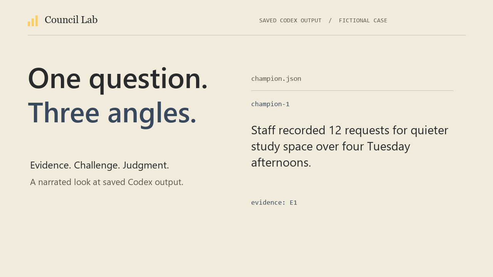
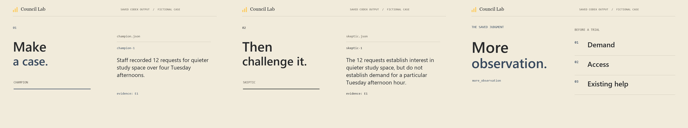

# Council Lab

[](#watch-the-24-second-overview)

A library is thinking about setting aside a quiet hour. Some visitors have asked for a quieter place to study, but others need help at the service desk. What should the library try first?

Council Lab lets you examine a small question like this from more than one angle. It keeps the supplied evidence visible, asks for a case in favor and a challenge to it, then asks for a judgment that accounts for each claim. The judgment ends with uncertainty and a next step for a person to consider. It does not make the decision or take action.

## Watch the 24-second overview

[Play or download the narrated MP4](media/council-lab-24s.mp4).

A narrated editorial animation of the [saved live Codex example](examples/recorded-live/README.md), using verbatim output excerpts and claim-by-claim highlights. The library case and evidence are fictional. The film typesets saved records; it is not a screen recording or a fresh execution. The voiceover is AI-generated. Read the [spoken script and production notes](media/README.md).

## Try the fictional example

You need Python 3.9 or later. No packages, account, network connection, or API key are needed for the walkthrough. Open a terminal in this folder:

```text
python walkthrough.py my-walkthrough
```

This is a **scripted walkthrough**. Its evidence and responses were written for the example; no model is called. The output includes the evidence, arguments, judgment, and suggested next step. Review it again with `python lab.py show my-walkthrough`. Choose a new directory name each time.

The point is not to prove that a quiet hour will help. The tally suggests a question worth looking into; it does not measure demand, accessibility, or what would happen to other services. The suggested next step is a small check a librarian could choose to make.

## Inspect the recorded live example

Three fresh Codex runs also examined this fictional case. You can [read the saved responses and test notes](examples/recorded-live/README.md), or inspect the complete record:

```text
python lab.py show examples/recorded-live/run
```

This is a **recorded live example**, saved on October 29, 2026. Viewing it does not run a model. The supporting case, challenge, and judgment passed the same validation used for manual responses. The judgment addressed all eight claims, identified ambiguity about what a quiet hour would mean, and suggested checking demand, access, and existing services before scheduling a trial. One example does not establish that the approach improves decisions.

## Change the question and try it with Codex

The editable case is [examples/library.json](examples/library.json). Copy it to a new JSON file and change the question, aim, evidence, sources, and unknowns. Keep the same field names and unique evidence IDs. Use fictional or material you are authorized to share; a prompt contains the entire case. If you change the example, start a new run rather than using the scripted responses.

1. Create a run in a **new** directory: `python lab.py start my-case.json my-run`.
2. Inspect it: `python lab.py show my-run`.
3. Print the first prompt: `python lab.py prompt my-run champion`. Copy it into a **fresh Codex chat** and ask for the JSON response. Save the response, without code fences, as a UTF-8 file such as `response.json`.
4. Admit it: `python lab.py submit my-run champion response.json`. If validation fails, correct the response against the printed packet and submit again.
5. Repeat the prompt and submit commands for `skeptic`, using a **fresh chat**, then for `elder`, again using a fresh chat. The skeptic packet includes the accepted supporting case; the elder packet includes both cases.
6. Run `python lab.py show my-run`. Read the evidence and reasoning, decide whether the uncertainty matters, and choose your own next step.

The commands read and write UTF-8 text, including when output is redirected to a file. They do not start Codex or verify which model produced a response. They accept operator-supplied JSON only. You can also write responses yourself. The validator checks the structure, packet binding, evidence IDs, and claim accounting; it cannot establish whether a citation actually supports a claim or whether reasoning is sound. Review those yourself. The `inference` field is where a role explains the step beyond the source, not a source itself.

## How the example works



The case is copied into the new run, and its content receives a fingerprint. Each role gets a packet for that exact case. The supporting role sees the case; the challenging role also sees the accepted supporting record; the judge sees both. A response must match the role and packet fingerprint. Evidence citations must refer to IDs in the case, and the judgment must address each claim once. Accepted response files are created once rather than overwritten by the commands. If you change an earlier input, later records no longer match; begin a new run to keep the old one readable.

These are useful **workflow boundaries**, not a security sandbox or a durable audit system. A fresh chat and the prompt ask Codex to restrict its context, but the app does not enforce what Codex can access. The operator controls the local files and can edit them; fingerprints bind outputs to inputs but are not signatures or proof of authenticity. Treat case content as untrusted, check model responses, and use only data you are comfortable placing in the chosen chat. There is no workspace enrollment, background observer, scheduler, live evidence collection, experiment execution, or automatic action.

See [SOURCE.md](SOURCE.md) for the source boundary and what this small edition omits. Council Lab is released under the [MIT license](LICENSE). Run checks with `python -m unittest discover -s tests -v`.
